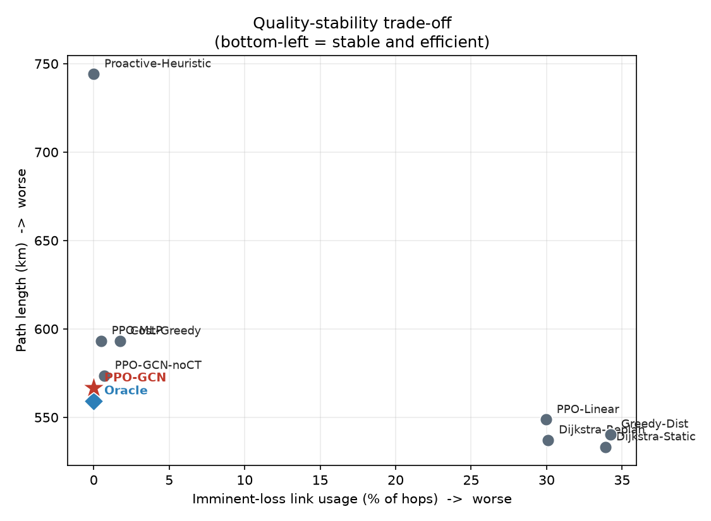
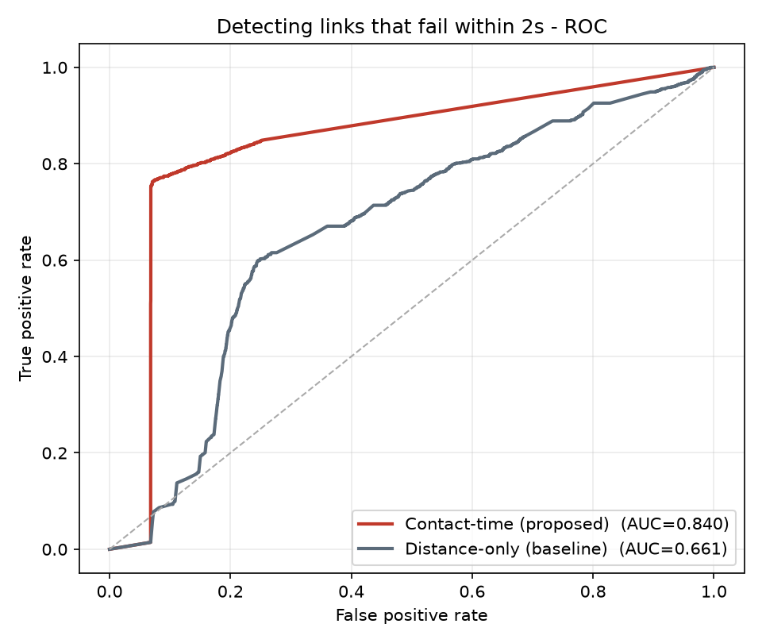

# AI 기반 네트워크 라우팅·운용 시스템


동적으로 토폴로지가 변하는 네트워크에서 라우팅을 강화학습으로 최적화하고,
그 위에 실제 통신망 운용에 필요한 기능(품질·트래픽 모니터링, 장애 선제 탐지,
최적해 대비 성능 검증, 컨테이너 기반 서빙·배포, 관측, 프로토콜 라우팅)을 붙여
**하나의 운용 가능한 시스템**으로 구현한 것이다.

<p align="center">
  
  
</p>
<p align="center"><sub>제안 라우팅 정책이 최적해(Oracle) 근처의 안정·효율 영역에 위치(좌) · 링크 단절을 사전 탐지 ROC-AUC 0.840(우)</sub></p>

라우팅 최적화부터 장애 선제 탐지, 컨테이너 배포·관측, 프로토콜 수렴·이중화까지
동적 네트워크 운용의 전 계층을 코드와 수치로 다룬다. (검증 환경은 대규모 저궤도(LEO) 위성 메시망.)

전체 구조와 인터페이스는 [`docs/ARCHITECTURE.md`](docs/ARCHITECTURE.md).

---

## 라우팅 지능 (AI·데이터)

| 기능 | 결과 | 위치 |
|---|---|---|
| 라우팅 정책 품질·트래픽 분석 | 곧 끊길 링크 사용 **0.0%** (최단경로 30~34%), 최적해 근접 | [`analysis/`](analysis/) |
| 링크 장애 선제 탐지 | 임박 단절 탐지 **ROC-AUC 0.840**, 거리 기반 대비 +0.179 | [`anomaly/`](anomaly/) |
| 최적해 대비 성능 검증 (OR-Tools) | optimality gap **1.83%**, CP-SAT 최적해 40/40 일치 | [`solver/`](solver/) |
| E2E 트래픽 가시성 | 연결성·지연·병목 링크·경로 다양성(독립경로 6) | [`traffic/`](traffic/) |
| 링크 장애 영향도 분석 | 링크별 criticality 랭킹, 단일 장애 평균 E2E 8.9km | [`impact/`](impact/) |

## 플랫폼·운용 (인프라)

| 기능 | 결과 | 위치 |
|---|---|---|
| 컨테이너 서빙 · **Kubernetes** 배포 | 라우팅 정책 REST 서빙, kind 클러스터 배포·오토스케일 | [`serving/`](serving/) |
| **Prometheus + Grafana** 관측 | `/metrics` → 스크레이프 → 대시보드, 실기동 검증 | [`observability/`](observability/) |
| **BGP/OSPF** 프로토콜 라우팅 (FRR) | OSPF Full 인접 · eBGP 수렴 · 링크장애 재수렴 | [`netlab/`](netlab/) |
| **Terraform / EKS** 클라우드 IaC | VPC+EKS 정의, `terraform validate` 통과 | [`terraform/`](terraform/) |
| **CI/CD** (GitHub Actions) | push마다 실험 검증 + 컨테이너 빌드·기동 | [`.github/workflows/ci.yml`](.github/workflows/ci.yml) |

각 폴더의 `README.md`에 방법·수치·검증 결과가 정리되어 있다.

---

## 빠르게 보기

```bash
# 라우팅 지능
pip install pandas numpy matplotlib scikit-learn ortools networkx fastapi "uvicorn[standard]" torch
python analysis/ops_analysis.py --episodes data/episodes_all_v2.csv --out analysis
python anomaly/detect.py --out anomaly
python solver/optimality_gap.py --episodes data/episodes_all_v2.csv --out solver
python traffic/visibility.py --out traffic
python impact/criticality.py --out impact

# 플랫폼·운용 (Docker)
docker compose -f serving/docker-compose.yml up --build         # 라우팅 서빙
docker compose -f observability/docker-compose.yml up --build   # 관측 스택
docker compose -f netlab/docker-compose.yml up -d               # BGP/OSPF 라우팅
# Kubernetes 배포: serving/README.md   ·   클라우드 IaC: terraform/README.md
```

---

## 구조

```
AI-Network-Routing/
  analysis/       라우팅 품질·트래픽 분석
  anomaly/        링크 장애 선제 탐지 (ROC/PR)
  solver/         OR-Tools 최적해 대비 성능 검증
  traffic/        E2E 트래픽 가시성 (networkx)
  impact/         링크 장애 영향도·criticality
  serving/        컨테이너 서빙 + Kubernetes 배포 (FastAPI)
  observability/  Prometheus + Grafana 관측
  netlab/         BGP/OSPF 라우팅 (FRRouting)
  terraform/      EKS 클라우드 IaC
  docs/           시스템 아키텍처
  .github/        CI/CD
  sim/            네트워크 물리·정책·토폴로지
  data/           라우팅 실험 결과
```

`sim/`의 라우팅 정책·환경은 석사 연구 산출물이며, 이 저장소는 그 위에
**운용·플랫폼 계층**을 구현한 것이다. `netlab/`은 프로토콜 구성을 다룬 실습 랩이다.
