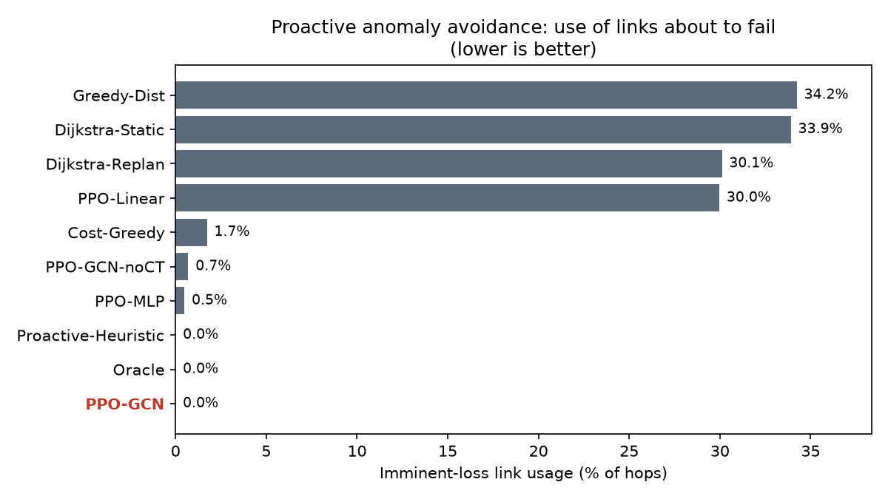
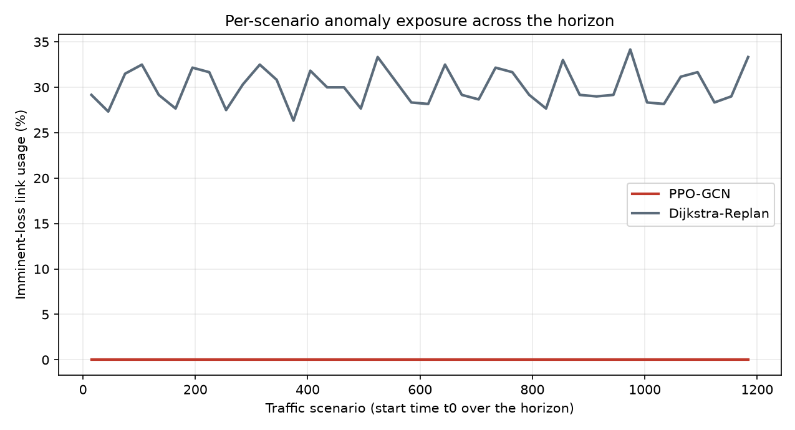
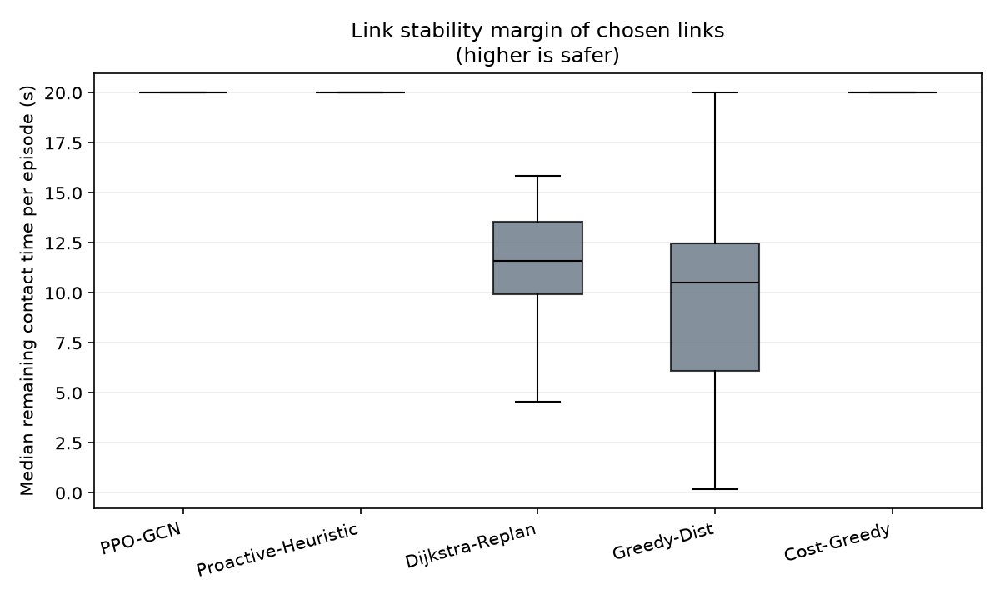

# Network Operations Analysis

An operations-oriented reading of the AI routing policy: end-to-end quality, proactive avoidance of imminent link failures, per-scenario traffic patterns, and link stability margin.

- Data: `79,200` episodes over `1,200` network scenarios (start times across the orbital horizon).

> Framing note: the study domain is a low-earth-orbit satellite mesh, but the operational questions - keep delivery high, avoid links that are about to drop, stay efficient, hold a safety margin - are the same ones any dynamic packet network faces.

## 1. End-to-end quality and efficiency

| Method | Description | Success | Path (km) | Hops |
|---|---|---|---|---|
| Oracle | Offline optimum (full future knowledge) - upper bound | 100.0% | 559.3 | 6.18 |
| Dijkstra-Static | Plan once on the initial snapshot | 88.0% | 533.3 | 3.97 |
| Dijkstra-Replan | Recompute shortest path every hop | 100.0% | 537.2 | 4.05 |
| Greedy-Dist | Always hop to the neighbor closest to destination | 100.0% | 540.4 | 4.07 |
| Cost-Greedy | Greedy on the per-hop cost score | 100.0% | 593.1 | 5.17 |
| Proactive-Heuristic | Hand-tuned contact-time heuristic | 100.0% | 744.2 | 14.26 |
| PPO-Linear | RL policy, linear features | 100.0% | 548.7 | 4.01 |
| PPO-MLP | RL policy, MLP | 100.0% | 593.3 | 5.44 |
| PPO-GCN-noCT | RL + graph encoder, no contact-time input | 100.0% | 573.7 | 5.52 |
| **PPO-GCN** | Proposed: RL + graph encoder + contact-time | 100.0% | 566.6 | 5.64 |

The proposed policy delivers **100.0%** of traffic. It is not the shortest path - it trades roughly a few percent of path length for stability (see section 2), which is the intended behaviour, not a defect.

## 2. Proactive anomaly avoidance (imminent link loss)

An *imminent-loss link* is one predicted to drop within the contact-time window. Using such a link is the operational anomaly the policy is meant to pre-empt.

- Proposed policy: **0.0%** of hops use an imminent-loss link.
- Shortest-path / greedy baselines: ~**33%** - they pick the nearest hop and walk straight into links that are about to fail.

The policy predicts remaining link life and routes around failures before they happen, rather than reacting after a drop.

## 3. Per-scenario traffic patterns

Each start time is a different network snapshot. Watching a metric across scenarios is the monitoring view an operator would keep on a dashboard.

Anomaly exposure for the shortest-path baseline swings with the scenario, while the proposed policy holds near zero across the whole horizon - stable behaviour regardless of the traffic snapshot.

## 4. Link stability margin

Remaining contact time of the links a method chooses - how much life is left when the link is used. Higher means a bigger safety buffer.

- Proposed policy median margin: **20.0 s** (capped at 20 s), min **20.0 s**.
- Reactive baselines sit far lower - they commit to links with little life left, which is why their imminent-loss usage is high.

## 5. Honest limits

- Path length is not the best; the proposed policy is a few percent longer than pure shortest-path. That is the cost of avoiding fragile links, not an efficiency loss to hide.
- Delivery reaching 100% is partly due to per-hop decision making; re-planning every hop also reaches 100%. The policy's distinct value is the near-zero imminent-loss usage at that success level.
- `Oracle` is a genuine offline upper bound (full future knowledge). The remaining gap to it is the price of deciding online.

---

*Generated by `ops_analysis.py`. Figures in `figures/`.*
