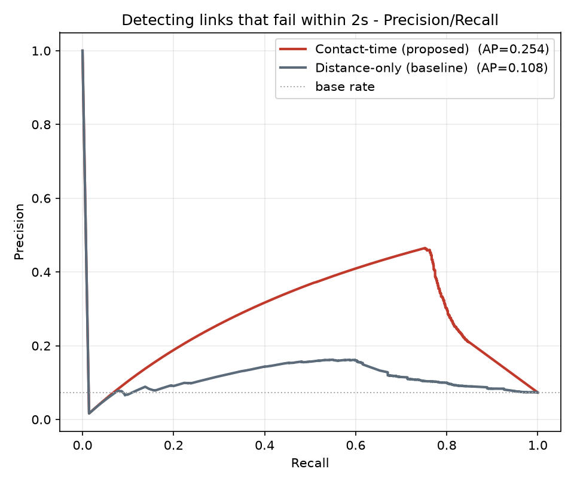
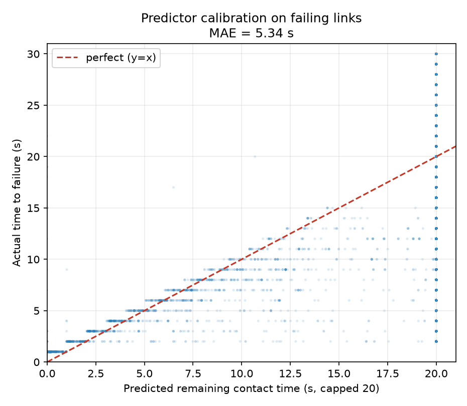

# Proactive Link-Failure Anomaly Detection

Treats the routing model's remaining-contact-time predictor as an anomaly detector for imminent link loss, and measures how well it flags real failures before they happen - benchmarked against a distance-only baseline.

- Samples: `393,661` live links across the full horizon (every second, all in-range satellite pairs).
- Look-ahead window: `30` s; `72.6%` of live links fail within it.
- Ground truth is the simulator's own future; predictors use only information available at decision time. No weights, no training.

> Framing: spotting a link about to drop *before* it drops is the core of proactive fault management in any dynamic network. Here the link is a satellite ISL, but the detection problem is the one an NOC watches for.

## Detector comparison

Ranking quality (threshold-independent): higher is better.

| Imminent horizon | Base rate | Detector | ROC-AUC | Avg precision |
|---|---|---|---|---|
| fails within 2s | 7.3% | Contact-time (proposed) | 0.840 | 0.254 |
| fails within 2s | 7.3% | Distance-only (baseline) | 0.661 | 0.108 |
| fails within 5s | 17.9% | Contact-time (proposed) | 0.777 | 0.371 |
| fails within 5s | 17.9% | Distance-only (baseline) | 0.598 | 0.202 |

The contact-time detector uses the *direction* of relative motion, so it separates approaching from receding links near the range edge - worth **+0.179 ROC-AUC** over the distance-only snapshot at the 2s horizon.

## Operating point

At the router's own rule - *flag if predicted contact time <= horizon* - the proposed detector reaches:

| Imminent horizon | Precision | Recall | F1 |
|---|---|---|---|
| fails within 2s | 46.3% | 74.7% | 0.572 |
| fails within 5s | 62.6% | 59.0% | 0.608 |

## Predictor calibration

On links that actually fail within the window, predicted remaining life tracks real time-to-failure with **MAE = 5.34 s**.

## Honest limits

- One-slot linear extrapolation is most accurate for near-term failures and degrades with the horizon - which is the regime proactive routing actually needs.
- Recall is high but precision is moderate at the tight threshold: the detector errs toward flagging, which for routing means caution, not a missed failure.
- Ground truth is the simulator, not measured telemetry; the contribution is the detection *method*, portable to real link metrics.

---

*Generated by `detect.py`. Figures in `figures/`.*
