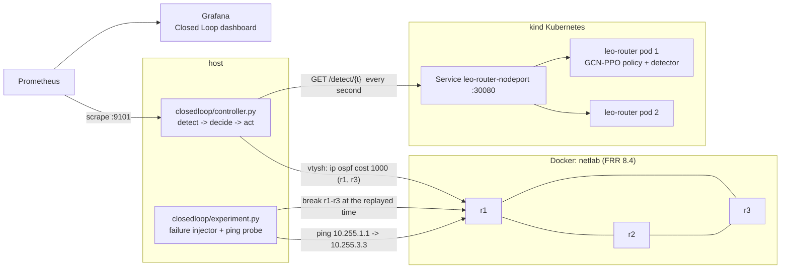
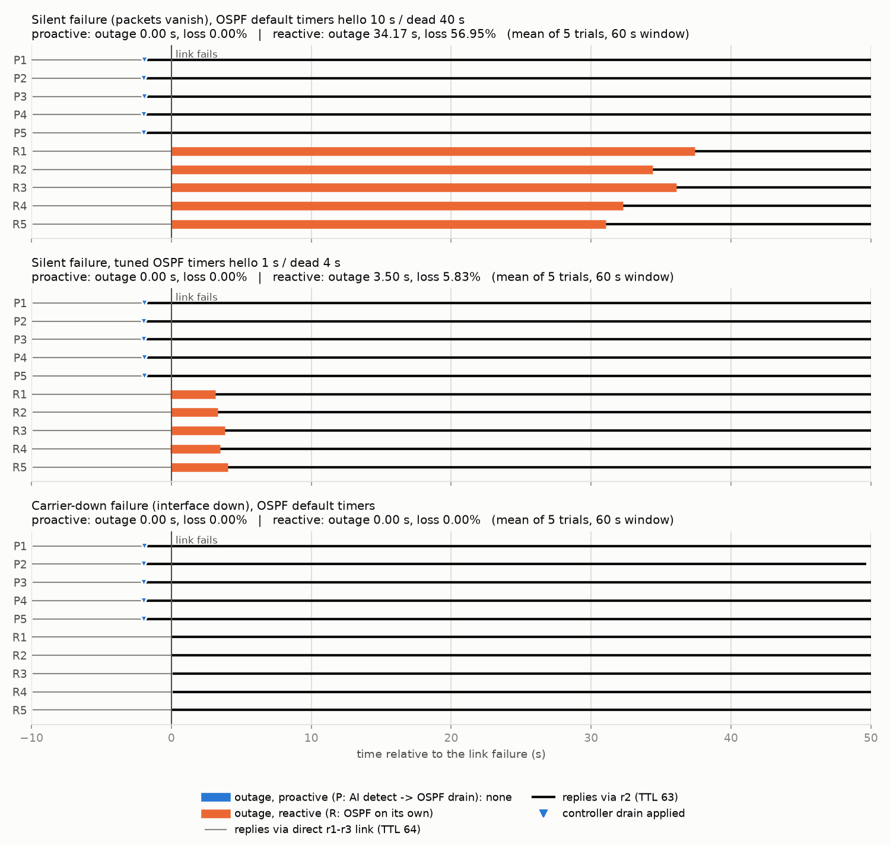

# Closed Loop: AI Detection -> OSPF Drain on a Live Lab

The routing policy's imminent-link-loss detector, served on **Kubernetes**,
drives a running **OSPF** network: a controller polls the detector, and when
the link it watches is flagged it drains that link (raises its OSPF cost on
both ends) so traffic moves to the backup path **before** the link fails.
Detection, action, measurement and metrics are one connected flow:



> **What this is, exactly:** an **emulation**. One satellite link's lifetime
> from the simulator (`sim/`) is replayed on one link of a 4-router FRR lab,
> in real time. The lab is not a constellation and not a production network;
> the controller acts on real routing daemons and the loss is measured on
> real packets.

## The replayed link

The satellite link is chosen from the simulator by a fixed rule
([`scenario.py`](scenario.py), result in [`scenario.json`](scenario.json)),
not by hand:

1. Every link break in the 1,200 s horizon: **14,360** (pair in range at
   t-1, out of range at t).
2. Split by kind. **7,285 gradual** breaks: the pair drifts past the 150 km
   range (about 8.5 km/s relative drift, median) - a link that expires.
   **7,075 discontinuous** breaks: a satellite wraps around at the edge of
   the bounded simulation area (distance jumps by hundreds of km). The
   wrap-around is a modelling boundary, not link physics, so only gradual
   breaks are replayed.
3. Lead time = seconds from the detector's first flag (serving `/detect`,
   `tau_s=2.0`) to the break. Gradual breaks: flagged ahead in 100% of cases,
   but the lead is short - **2 s for 6,649** (91.3%), 1 s for 570 (7.8%),
   3-4 s for 66. The replayed link has the **median lead (2 s)**.
4. Earliest such break, live through a 10 s healthy period before the flag.

| | Simulator | Lab |
|---|---|---|
| Link | satellites **26-44** | **r1-r3** (10.0.13.0/24) |
| Healthy | t = 4..13 s (137-148 km) | direct path, OSPF cost 10 |
| Flagged by `/detect` | t = 14 (pred 1.09 s), t = 15 (pred 0.07 s) | controller drains: cost 1000 on r1 and r3 |
| Breaks | t = 16 (154 km > 150 km) | failure injected on both ends |
| Backup | - | r1-r2-r3 (cost 20) |

Replay: t = 4..66, **1 simulated second = 1 wall-clock second** (no time
compression). The failure injector runs on its own thread from the
simulator's ground truth; the controller only sees the detector.

## Failure emulation and OSPF timers

`ip link set down` gives the routers an instant carrier-loss signal, which is
not how an expiring link behaves. The main condition is therefore a
**silent failure**: `tc netem loss 100%` on the r1-r3 interface of both r1
and r3 - carrier stays up, packets and OSPF hellos vanish, and OSPF only
notices through its dead interval.

| Condition | Failure | OSPF timers on r1-r3 |
|---|---|---|
| `silent-default` (main) | netem 100% loss, both ends | hello 10 s / dead 40 s |
| `silent-fast` (sensitivity) | netem 100% loss, both ends | hello 1 s / dead 4 s |
| `carrier-default` (secondary) | `ip link set down`, both ends | hello 10 s / dead 40 s |

- `netlab/r*/frr.conf` set no timers, so the lab runs FRR's defaults: hello
  10 s, dead 40 s, wait 40 s (read back with `show ip ospf interface`). SPF
  throttle 0 / 50 / 5000 ms, LSA min interval 5 s.
- `silent-fast` sets hello 1 / dead 4 at runtime on r1-r3 only, to show how
  much of the gap is just timer choice. BFD was not tested (it would shrink
  the reactive gap further, below a second).

## Measurement

- **Probe**: `ping -i 0.1` from r1, sourced from its loopback 10.255.1.1, to
  r3's loopback 10.255.3.3 - a round trip that uses r1-r3 in both directions
  while it is up. The reply TTL shows the return path (64 direct, 63 via r2).
- **Modes**: *proactive* = controller acts on the detector; *reactive* =
  same polling, no action (OSPF recovers on its own).
- **Window**: [failure - 10 s, failure + 50 s] on the router clock, for every
  trial.
- **Outage** = longest time between two answered probes with lost probes in
  between (0 when nothing is lost). **Loss** = share of the 60 s window
  without answers, i.e. the packet loss a constant 10 pkt/s stream would
  see. ping's own count is also kept (`loss_pct_sent`) but understates a
  silent failure: while the dead neighbour's ARP entry is unresolved the
  kernel holds ping's packets, ping's small socket buffer fills, and it
  sends only about 5 probes per 3 s ARP cycle. Send times come from the
  router clock (reply time minus RTT, and ping's "no answer yet" lines), not
  from a fixed 0.1 s grid. ping is stopped with `timeout -s INT`, not
  `ping -w`, because with a deadline iputils ping exits on its first error
  (an early version of this experiment lost the recovery that way).
- Each trial starts from a clean state (link restored, OSPF Full, both
  loopbacks on the direct path, then 6 s settle); modes are interleaved
  P, R, P, R, ...; 5 trials per mode and condition.

## Results

Measured on the live lab, 5 trials per cell (mean ± std, sample std; min-max
in brackets). Loss is over the 60 s window.

| Failure | OSPF timers | Mode | Outage (s) | Loss (%) | Lost probes (ping count) | Drain before failure |
|---|---|---|---|---|---|---|
| silent (netem) | 10 / 40 s (default) | **proactive** | **0.00** ± 0.00 | **0.00** | 0 | 1.97 s (5/5 off-link) |
| silent (netem) | 10 / 40 s (default) | reactive | 34.17 ± 2.62 [30.98-37.33] | 56.95 ± 4.37 | 168.2 (39.5%) | - |
| silent (netem) | 1 / 4 s (tuned) | **proactive** | **0.00** ± 0.00 | **0.00** | 0 | 1.97 s (5/5 off-link) |
| silent (netem) | 1 / 4 s (tuned) | reactive | 3.50 ± 0.35 [3.12-3.95] | 5.83 ± 0.58 | 33.6 (5.84%) | - |
| carrier down | 10 / 40 s (default) | proactive | 0.00 ± 0.00 | 0.00 | 0 | 1.97 s (5/5 off-link) |
| carrier down | 10 / 40 s (default) | reactive | 0.00 ± 0.00 | 0.00 | 0 | - |

"off-link" = at the instant of the failure, both r1 and r3 already routed the
probe's loopbacks away from r1-r3 (`ip route get`, captured in the same
command that injected the failure).



What the numbers say:

- **Proactive lost no probes in any of its 15 trials.** The controller saw
  the flag at t = 14 (every trial), drained r1-r3 1.95-1.99 s before the
  failure, and the return path moved to r2 0.04-0.16 s after the drain
  command finished (reply TTL 64 -> 63, at the probe's 0.1 s resolution).
- **Silent failure, default timers: reactive loses 34.2 ± 2.6 s**, which is
  the OSPF dead interval (40 s) minus the time since the last hello. The
  closed loop removes this outage entirely, since the traffic has already
  moved when the link fails.
- **Tuned timers (1 / 4 s) shrink the reactive outage to 3.5 ± 0.4 s**, and
  proactive still removes it. Much of the default-timer gap is timer choice,
  which is why this condition is reported.
- **Carrier-down: no measurable difference.** With an instant carrier signal
  OSPF reroutes within one 0.1 s probe interval, so reactive also lost no
  probes. The loop only helps when a failure is not signalled at once.
- Controller -> Kubernetes: 1,890 `/detect` calls over the run, 0 errors,
  about 7 ms mean latency; both replicas served requests (NodePort
  load-balancing).
- Probe coverage: in 2 of 30 trials (carrier-down proactive #2 and #4) ping
  paused for about 2.1 s, at -5.3 s and +19.3 s, away from the failure. Every
  trial had full probe coverage from 1 s before to 2 s after the failure.

Raw data: [`results/trials.csv`](results/trials.csv) (one row per trial),
[`results/summary.csv`](results/summary.csv),
[`results/summary.json`](results/summary.json) (environment + summary),
`results/probes.csv.gz` (every probe), `results/events.csv.gz` (every
detect call), `results/ping_raw.txt.gz` (raw ping output).

## Observability

The controller exports Prometheus metrics on `:9101` (detect calls and
latency, flag / drain / failure state of the link, live probe counters,
last-trial loss / outage / drain lead). Prometheus scrapes it as job
`closedloop-controller`; Grafana provisions the **Closed Loop (detect ->
drain)** dashboard (`observability/grafana/dashboards/closedloop.json`), with
a state timeline of flag -> drain -> failure. Verified during the runs:
target up, `closedloop_*` series queryable in Prometheus and through Grafana,
both dashboards provisioned. Metric list: [`observability/README.md`](../observability/README.md).

## Reproduce

```bash
pip install -r closedloop/requirements.txt
bash closedloop/run.sh           # lab + kind + Prometheus/Grafana + experiment
# or step by step:
docker compose -f netlab/docker-compose.yml up -d
kind create cluster --name leo --config closedloop/k8s/kind-cluster.yaml
kind load docker-image leo-router:latest --name leo
kubectl apply -f serving/k8s/deployment.yaml -f closedloop/k8s/router-nodeport.yaml
HOST_GATEWAY_IP=192.168.5.2 docker compose -f observability/docker-compose.yml up -d --no-deps prometheus grafana   # colima
python closedloop/controller.py              # one replay, watch it drain
python closedloop/experiment.py --trials 5   # the measured experiment
python closedloop/plot.py                    # figure from results/
```

`python closedloop/scenario.py --check` and `python
closedloop/test_closedloop.py` need no Docker and run in CI.

## Honest limits

- **Emulation, one link.** A satellite link's timeline is replayed on one
  link of a 4-router Docker lab. The lab topology does not model the
  constellation; only the timing of one link expiry is carried over.
- **Ground truth and detector share the simulator.** The detector's one-slot
  extrapolation reads the next-second orbital geometry, which is
  deterministic for satellites; that is why every gradual break is flagged
  ahead here. On links whose failure is not predictable from geometry the
  detector would miss some failures (then the loop behaves like reactive).
- **Short lead.** The lead is 2 s (1 s for 7.8% of gradual breaks). It is
  enough here because a local OSPF cost change reroutes in well under a
  second; a slower actuation path (config push through an NMS) might not fit.
- **One true-positive event.** The scenario is a correctly flagged link.
  False positives (the detector's precision is 46% at the 2 s horizon, see
  [`anomaly/`](../anomaly/)) are not exercised; in this loop their cost is
  traffic on the longer r1-r2-r3 path, not loss.
- **The gain is the reactive detection gap.** Proactive removes the time
  OSPF needs to notice a failure. That gap is set by the reactive mechanism:
  34 s with default timers, 3.5 s with tuned timers, below the 0.1 s probe
  resolution with carrier loss (no measurable gain), and it would shrink
  further with BFD (not tested). The probe is ICMP at 10 packets/s, so
  sub-100 ms effects are not resolved.
- **Controller on the host.** It is a Python process calling the K8s Service
  through a NodePort and configuring routers with `docker exec vtysh`, not an
  in-cluster operator using NETCONF/gNMI. The drain is latched until the
  experiment restores the link; there is no automatic undrain.
- The K8s-served router's own `/metrics` are not scraped here (the NodePort
  load-balances across replicas; per-pod scraping needs an in-cluster
  Prometheus). Single machine (colima VM, 2 CPUs), 5 trials per cell.

## Files

```
closedloop/
  scenario.py          picks the replayed satellite link from the simulator (rule above)
  scenario.json        the chosen link, its trace and the break statistics
  controller.py        the loop: poll /detect -> drain via OSPF cost; Prometheus metrics
  lab.py               FRR lab driver (docker exec: vtysh, tc netem, ip link, routes)
  experiment.py        trials: failure injection, ping probe, loss/outage analysis
  plot.py              results/fig_closedloop.png
  test_closedloop.py   logic tests without Docker (CI)
  run.sh               end-to-end run
  requirements.txt     host-side Python deps
  k8s/                 kind cluster config (host port 30080) + NodePort Service
  results/             measured data and figure
```
