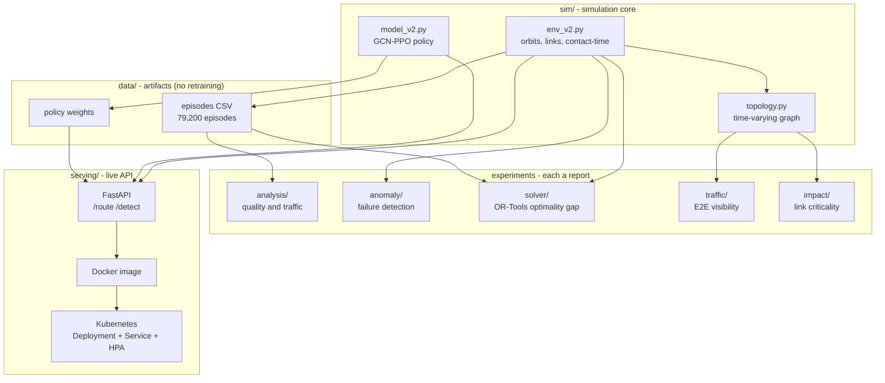

# System Architecture

How the pieces of this portfolio fit together: one simulation core feeds a
set of independent analysis, optimization, and serving components, each a
self-contained experiment with its own report.

## Overview

The system takes a single research artifact - a trained reinforcement-learning
routing policy for a dynamic satellite mesh - and turns it into the things a
network operator actually needs: quality analytics, proactive fault detection,
an optimality benchmark, end-to-end visibility, impact analysis, and a live
serving API.



## Components and interfaces

| Component | Input | Output | Interface |
|---|---|---|---|
| `sim/env_v2.py` | time `t` | positions, distances, contact time, reward | `positions(t)`, `pair_dist(t)`, `step(a)` |
| `sim/model_v2.py` | state tensors | next-hop logits, value | `PPOAgentV2.act(x, adj, edge, mask, carrier)` |
| `sim/topology.py` | time `t` | networkx graph, E2E route | `build_graph(t)`, `e2e_path(t)` |
| `analysis/` | episodes CSV | quality/traffic report | CLI script |
| `anomaly/` | env physics | ROC/PR detection report | CLI script |
| `solver/` | env physics + CSV | optimality-gap report | CLI + OR-Tools CP-SAT |
| `traffic/` | topology | E2E visibility report | CLI + networkx |
| `impact/` | topology | criticality report | CLI + networkx |
| `serving/` | HTTP request | route / anomaly JSON | REST: `GET /route/{t0}`, `GET /detect/{t0}` |

### Serving API contract

```
GET /health            -> {"status": "ok"}
GET /route/{t0}        -> {t0, path:[sat...], hops, reward, success,
                          steps:[{from, to, pred_contact_s, risky}]}
GET /detect/{t0}?tau_s -> {t0, tau_s, n_live_links, n_imminent,
                          links:[{i, j, pred_contact_s}]}
```

## Design decisions

- **Reuse, don't retrain.** Every experiment consumes existing trained
  artifacts (weights, episode logs) or pure physics, so the whole system
  reproduces on a laptop in minutes and needs no GPU.
- **One core, many consumers.** The simulator and policy live in `sim/`; each
  experiment depends only on that core, never on another experiment. A reader
  can run any one in isolation.
- **Every claim is executable.** Reports are generated by their scripts, not
  written by hand; the solver even re-executes its own solutions in the
  environment to prove the numbers.
- **Separation of concerns for deployment.** The research code is read-only
  input to the serving layer; the container packages inference only, which is
  the boundary a production system would draw.

## Reproduce

```bash
python3 -m venv .venv && source .venv/bin/activate
pip install pandas numpy matplotlib scikit-learn ortools networkx fastapi uvicorn torch

python analysis/ops_analysis.py --episodes data/episodes_all_v2.csv --out analysis
python anomaly/detect.py --out anomaly
python solver/optimality_gap.py --episodes data/episodes_all_v2.csv --out solver
python traffic/visibility.py --out traffic
python impact/criticality.py --out impact
# serving: see serving/README.md
```
