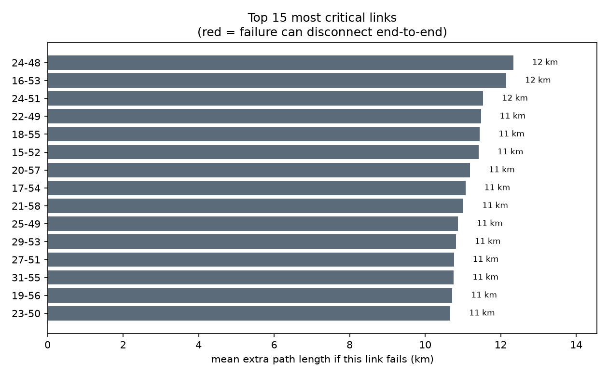
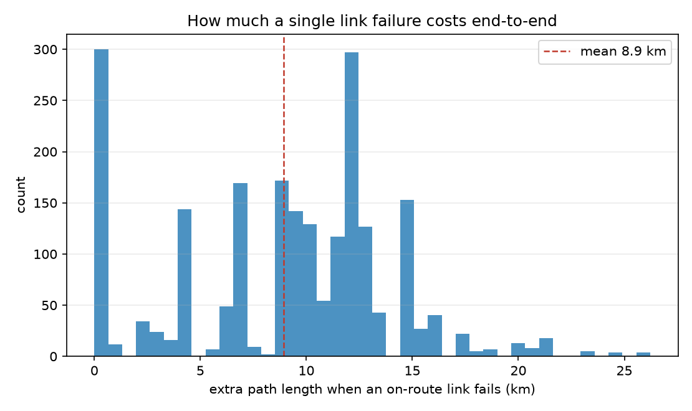

# Link-Failure Impact Analysis

Ranks links by how much their failure would hurt end-to-end service - the information needed to prioritize monitoring, spares, and protection, rather than treating every alarm equally.

- Evaluated `2,153` link-on-route failure scenarios across the horizon.
- A single on-route link failure adds on average **8.9 km** of path (median 9.8, 95th percentile 16 km).
- Of those, **0** cases disconnect end-to-end outright (a single point of failure at that moment).

## Most critical links

Ranked by total end-to-end delay their failure would add over the horizon; red bars are links whose failure can cut the route entirely.

The single most critical link (`24-48`) sits on the shortest route `5` times; when it fails the route lengthens by **12 km** on average.

## Distribution of failure cost

Most single-link failures are absorbed cheaply thanks to path diversity; a thin tail of links carries disproportionate risk - those are the ones worth watching first.

## Honest limits

- Impact is measured as extra shortest-path length; weighting by real traffic volume or latency budget refines it and uses the same method.
- Single-link failures only; correlated multi-link outages would extend this to k-of-n resilience.

---

*Generated by `criticality.py`. Figures in `figures/`.*
