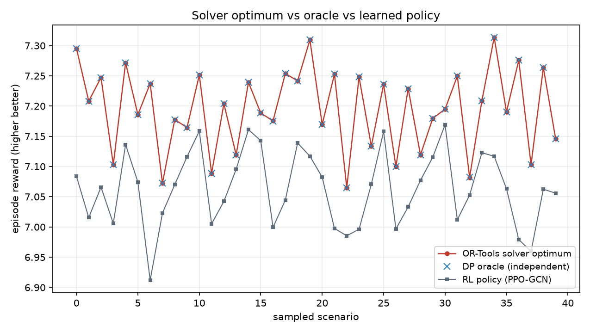

# Optimality Gap via OR-Tools Solver

Formulates the offline-optimal route (full future knowledge) as a maximum-reward path with a turn penalty and solves it with OR-Tools CP-SAT, to measure how close the learned routing policy comes to the true optimum.

> The antenna-alignment cost couples two consecutive hops, so the problem is a shortest path *with turn penalties* - the state is (previous, current). This is a genuine combinatorial optimization, not a plain shortest path.

## Validation

- **40/40** solved routes reproduce their solver objective exactly when executed in the environment (|reward - objective| < 1e-3).
- Solver optimum vs the independently implemented DP oracle: mean |difference| = **0.000051** - the two agree, cross-validating both.
- The optimum dominates the policy on every scenario: **True**.

## Optimality gap

Across 40 scenarios, the learned policy (PPO-GCN) reaches within **1.83%** of the solver optimum (mean reward gap 0.132).

The point of the gap is not just the number: the optimum needs full future knowledge and per-scenario solving, while the policy decides online, hop by hop, in microseconds. The gap is the price of that online, real-time operation - and it is small.

## Why a solver here

- Turns a heuristic comparison into an **optimality certificate**: we know exactly how much performance is left on the table.
- The same OR-Tools formulation extends to capacity, latency, or load-balancing constraints that a shortest path cannot express.

## Honest limits

- The optimum is offline and omniscient; it is an upper bound, not a deployable router.
- Solved on the horizon-limited time-expanded graph; the reward structure keeps optimal paths short, so the horizon does not bind.

---

*Generated by `optimality_gap.py`. Figure in `figures/`.*
