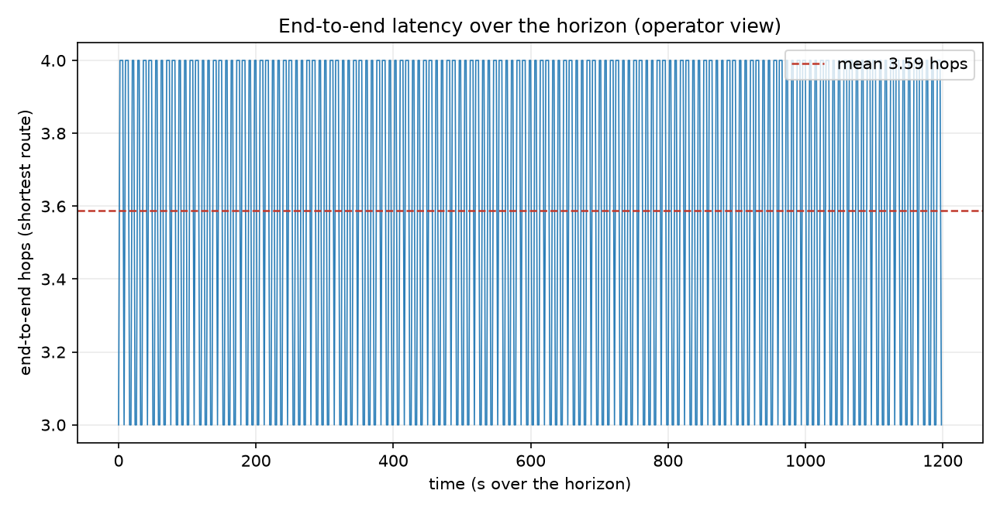
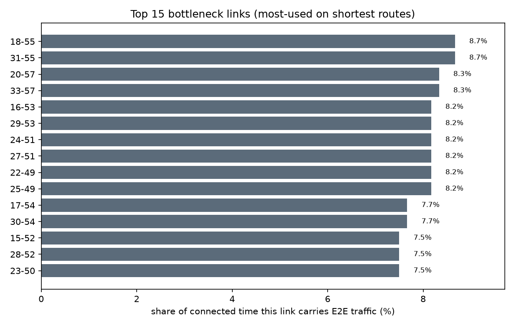
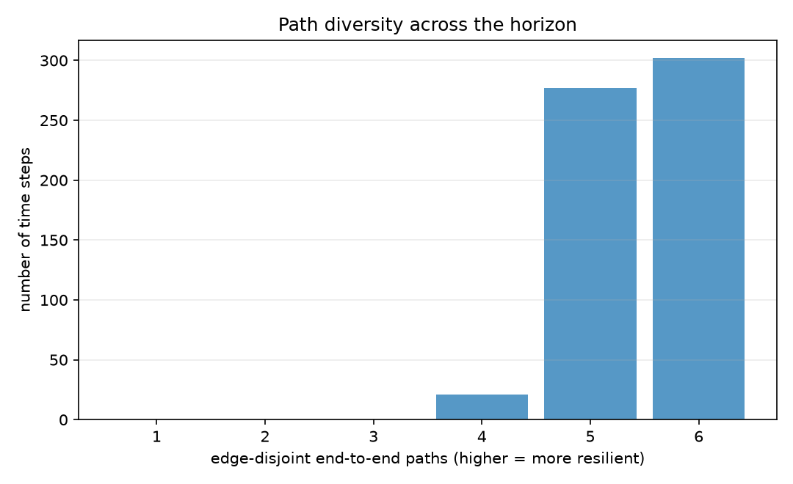

# End-to-End Traffic Visibility

The network seen the way an operations center would see it: live reachability, end-to-end latency, which links are bottlenecks, and how much path redundancy there is - all on the time-varying topology.

- Sampled `600` time steps; source and destination are connected `100.0%` of the time.
- End-to-end latency when connected: mean **3.59 hops** (median 4, max 4), mean path **454 km**.

## Latency over time

## Bottleneck links

Aggregating which links lie on the shortest end-to-end route reveals the ones carrying the most traffic - the first place to watch for congestion or to add capacity.

- Busiest link carries end-to-end traffic **8.7%** of the connected time.

## Resilience (path diversity)

The number of edge-disjoint end-to-end paths is how many independent link failures the network can absorb before the source is cut off.

- Median **6** independent paths; a single point of failure (only one path) exists **0.0%** of the connected time.

## Honest limits

- Traffic is modeled as a single source-destination demand; real load would weight links by per-flow volume, which this method takes directly once flow data is available.
- Shortest path uses geometric distance as the latency proxy; swapping in measured link delay is a one-line change.

---

*Generated by `visibility.py`. Figures in `figures/`.*
